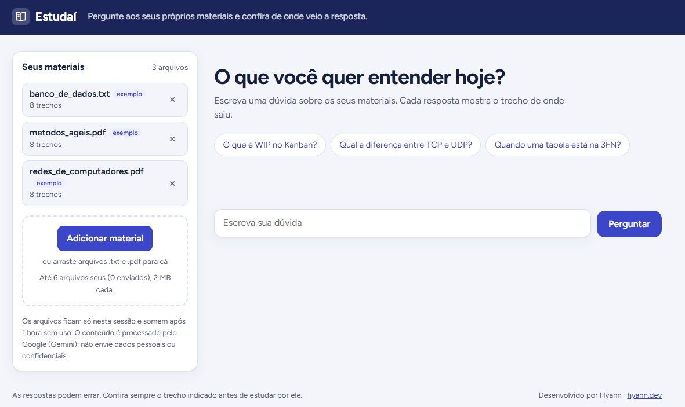

# Estudaí

Assistente de estudos que responde perguntas **somente com base nos seus materiais** e mostra de qual trecho veio cada resposta. Você usa os exemplos ou envia seus próprios arquivos `.txt` e `.pdf`, pergunta em linguagem natural e confere a fonte antes de estudar por ela.

**Teste online:** https://estudai-woad.vercel.app



> As respostas podem errar. Confira sempre o trecho indicado.

## O problema

Modelos de linguagem respondem com confiança mesmo quando não sabem, e quem estuda precisa saber **de onde** veio a informação. O Estudaí usa RAG (geração aumentada por recuperação): busca os trechos mais relevantes dos materiais, entrega só eles ao modelo e recusa responder quando nada nos materiais sustenta a resposta.

## Como funciona

1. **Divisão em trechos:** o texto é dividido por seções numeradas (`1. Título`), com o título do documento em cada trecho. Quando não há seções, usa blocos de 800 caracteres com sobreposição de 100.
2. **Embeddings:** cada trecho vira um vetor de 768 dimensões com `gemini-embedding-001`. A busca compara a pergunta com os trechos por similaridade de cosseno (NumPy).
3. **Recuperação:** os 3 trechos mais próximos são selecionados. Se o melhor ficar abaixo do limiar de relevância (0,61), o sistema responde "Não encontrei isso nos seus materiais." sem chamar o modelo.
4. **Geração:** `gemini-3.1-flash-lite` responde apenas com o contexto recebido. O prompt manda ignorar instruções que estejam dentro dos materiais (defesa contra prompt injection) e há nova tentativa em falhas temporárias (429, 5xx e tempo esgotado).
5. **Fontes:** a resposta traz arquivo, número do trecho, pontuação e o texto do trecho, para conferência.

Cada visitante tem uma **sessão própria** (cookie `HttpOnly`) com os exemplos mais os arquivos que ele enviou. Nada é compartilhado entre visitantes.

## Avaliação

Há 15 perguntas de teste em `tests/perguntas.json`, com a fonte e a passagem esperadas, mais perguntas fora do assunto que devem ser recusadas. Rode com `python -m app.avaliar`.

| Versão | Fonte correta | Passagem correta |
|---|---|---|
| Trechos de 800 caracteres | 15/15 | 14/15 |
| Trechos por seção | 15/15 | 15/15 |

Calibração do limiar de relevância:

| | Pontuação |
|---|---|
| Menor pontuação em pergunta **dentro** do material | 0,681 |
| Maior pontuação em pergunta **fora** do material | 0,644 |
| Limiar adotado | 0,61 |

A falha da primeira versão era uma pergunta sobre desnormalização, cuja resposta ficava dividida entre dois blocos. A divisão por seção resolveu.

## Limitações

- **Base de exemplo pequena e fictícia.** São 3 arquivos escritos para o projeto. As métricas mostram que o pipeline funciona, não que ele generaliza para qualquer material.
- **Divisão por seção assume títulos numerados** (`1. Título`). Em arquivos sem esse padrão, cai no corte por tamanho, que é menos preciso.
- **Sessões e limite de uso ficam em memória.** Na Vercel (serverless) cada requisição pode cair numa instância diferente, então materiais enviados podem sumir e o limite não é uma barreira rígida. Para uso real seria preciso armazenamento compartilhado, como o Redis.
- **PDFs escaneados ou protegidos por senha são recusados.** Não há OCR.
- **Dependência externa.** Embeddings e respostas dependem da API do Gemini e da cota gratuita.
- **Respostas de modelo podem errar.** Por isso cada resposta mostra o trecho de origem.

## Privacidade

- O conteúdo dos arquivos e as perguntas são enviados ao Google (Gemini). A página pede para não enviar dados pessoais nem material confidencial.
- Os arquivos enviados ficam apenas na memória da sessão e somem após 1 hora sem uso. Nada é gravado em disco ou banco de dados.
- A chave da API fica em variável de ambiente, nunca no código nem no repositório.

## Limites de uso

| Item | Limite |
|---|---|
| Tipos de arquivo | `.txt` e `.pdf` |
| Tamanho por arquivo | 2 MB |
| Páginas por PDF | 40 |
| Arquivos enviados por sessão | 6 |
| Pergunta | 3 a 500 caracteres |
| Perguntas por visitante | 6 por minuto |
| Envios por visitante | 10 por hora |
| Requisições totais | 300 por hora |

Ao passar de um limite de requisições a API responde `429` com `Retry-After`.

## Como rodar localmente

Requisitos: Python 3.12 e uma chave da API do Gemini.

```bash
git clone https://github.com/hyanndossantosespindas/estudai.git
cd estudai

python -m venv .venv
source .venv/Scripts/activate     # Windows (Git Bash)
# source .venv/bin/activate       # Linux e macOS

pip install -r requirements-dev.txt

cp .env.example .env              # depois edite o .env com a sua chave
python -m app.busca               # gera o cache de embeddings dos exemplos
uvicorn app.main:app --reload
```

Abra http://127.0.0.1:8000.

### Variáveis de ambiente

| Variável | Descrição | Padrão |
|---|---|---|
| `GEMINI_API_KEY` | Chave da API do Gemini (obrigatória) | – |
| `GEMINI_MODEL` | Modelo de geração | `gemini-3.1-flash-lite` |
| `LIMITE_PERGUNTAS_POR_MINUTO` | Perguntas por visitante a cada 60 s | `6` |
| `LIMITE_ENVIOS_POR_HORA` | Envios de arquivo por visitante a cada hora | `10` |
| `LIMITE_GERAL_POR_HORA` | Requisições totais por hora | `300` |

## Endpoints

| Método | Rota | Descrição |
|---|---|---|
| `GET` | `/` | Página do Estudaí |
| `GET` | `/saude` | Verificação de funcionamento |
| `GET` | `/materiais` | Lista os materiais da sessão |
| `POST` | `/materiais` | Envia um arquivo (`multipart`, campo `arquivo`) |
| `DELETE` | `/materiais/{nome}` | Remove um material |
| `POST` | `/perguntar` | Recebe `{"texto": "..."}` e devolve resposta e fontes |

Erros tratados: `400`, `404`, `409`, `413`, `422`, `429` (com `Retry-After`) e `503`.

## Testes

```bash
python -m pytest
```

Os testes cobrem API, índice, upload, sessões, limitador e geração de resposta. Embeddings e Gemini são substituídos por versões falsas, então rodam sem internet e sem chave.

## Estrutura

```
app/
  documentos.py   # leitura e divisão em trechos
  embeddings.py   # embeddings com o Gemini
  indice.py       # índice vetorial em memória
  busca.py        # exemplos e cache de embeddings
  materiais.py    # validação e processamento de uploads
  sessoes.py      # sessões por visitante
  limitador.py    # limite de uso por janela deslizante
  resposta.py     # prompt, geração e recusa
  avaliar.py      # avaliação com perguntas de teste
  main.py         # API FastAPI
  static/         # front-end (HTML, CSS, JS)
materiais/          # materiais de exemplo (fictícios)
cache/              # embeddings dos exemplos
tests/              # testes e perguntas de avaliação
vercel.json         # configuração do deploy
```

## Tecnologias

Python 3.12, FastAPI, NumPy, pypdf, Google Gemini API (embeddings e geração), pytest, Playwright (testes de interface), Vercel.

## Próximos passos

- Guardar sessões e limites em armazenamento compartilhado (Redis).
- Respostas em streaming.
- Ampliar a base de avaliação com materiais variados.
- Rodar testes e avaliação no GitHub Actions.

## Autor

Desenvolvido por Hyann dos Santos Espindas — [hyann.dev](https://hyann.dev)
